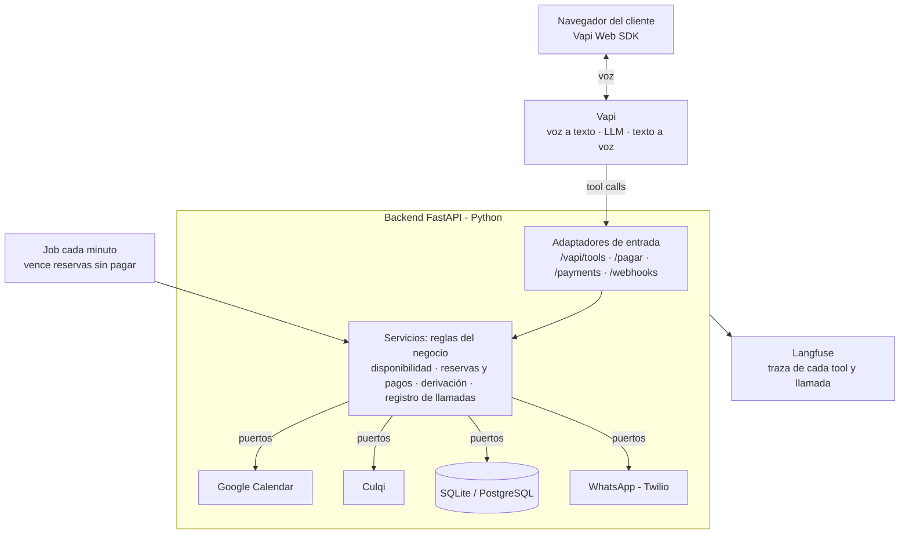

# Lucía — Recepcionista de voz con IA para un estudio de abogados

Agente de voz en español que atiende a los clientes de **Estudio Lex Andina** (estudio ficticio en Lima): responde preguntas, revisa la agenda real, reserva la consulta, envía el link de pago por WhatsApp y confirma la cita cuando se acredita el pago. Si hay una urgencia, deriva a una persona del estudio.

Construido con **Spec-Driven Development**, **arquitectura hexagonal** y **evaluación con golden cases** medida en llamadas reales.

> 🎥 **Video de 1 minuto:** _(pendiente de agregar)_

## Qué hace

- **Conversa por voz desde el navegador**, en español y con acento peruano.
- **Responde preguntas frecuentes** (áreas, precios, dirección, horarios) solo con la información del estudio, sin inventar.
- **Agenda en Google Calendar**: consulta los horarios libres reales y ofrece hasta 3 opciones.
- **Toma y confirma los datos** del cliente en voz alta, incluido el número de WhatsApp dígito por dígito.
- **Cobra con Culqi**: envía por WhatsApp un link a una página de pago propia (tarjeta, Yape, PagoEfectivo o billeteras).
- **Confirma o libera el horario**: si el pago se acredita, la cita pasa a CONFIRMADA y el cliente recibe la confirmación; si no paga en 30 minutos, el horario se libera solo.
- **Deriva a una persona** ante una urgencia (por ejemplo, una detención) o si el cliente lo pide, con un WhatsApp al responsable que incluye nombre, número, área y resumen.
- **Nunca da asesoría legal**, aunque el cliente insista.

## Resultados de la evaluación

13 escenarios de prueba (golden cases) corridos por voz contra 10 criterios de aceptación. Detalle completo en [`specs/evaluacion.md`](specs/evaluacion.md).

| Métrica | Resultado |
| --- | --- |
| Escenarios que cumplen | **13 de 13** (uno falló en la v1 y se corrigió) |
| Criterios de aceptación en verde | **8 de 10** |
| Número de WhatsApp capturado exacto | **100 %** (6 de 6) |
| WER del reconocimiento de voz | **8,0 %** (7 errores en 87 palabras) |
| Latencia de las tools (backend) | **478 ms** de promedio |
| Latencia por turno (lo que siente el cliente) | **1,81 s** de promedio (meta: 1,5 s, pendiente para la v2) |
| Costo por llamada | **US$ 0,065** de promedio (unos US$ 0,07 por minuto) |

### Lo que enseñó la evaluación

- **El LLM puede confirmar bien y enviar mal.** Lucía repetía el número correcto en voz alta, pero a la tool le mandaba 10 dígitos. La validación del backend lo frenó, y el error pasó a decir *cuántos* dígitos llegaron para que el modelo se corrija solo. Las garantías viven en código determinista, no en el prompt.
- **Las reglas de una tool van en la descripción de la tool.** "Envía el área de la derivación" no se cumplía escrita en el prompt general; escrita en la descripción del parámetro se cumplió a la primera.
- **El WER no es parejo.** 5 de los 7 errores del reconocimiento de voz estaban en las primeras palabras de la frase: el problema es el inicio del turno, no el modelo de transcripción.
- **El backend no es el cuello de botella.** Las tools responden en menos de 0,5 s; la latencia de 1,8 s está en el audio (fin de turno, LLM y voz sintética).

## Arquitectura



**Arquitectura hexagonal (puertos y adaptadores).** El núcleo con las reglas del negocio no sabe que existen Google, Culqi, Twilio ni el LLM: habla con interfaces (`Protocol`). El agente de voz es solo un adaptador de entrada más, igual que la página de pago o el webhook de Culqi. Por eso:

- Un horario ocupado **nunca** se reserva, aunque el LLM se equivoque: el servidor revalida.
- Los **136 tests** corren en menos de 2 segundos sin internet, con fakes de cada puerto.
- Cambiar de proveedor (Vapi → LiveKit, Culqi → otro, Twilio → API oficial de WhatsApp) es escribir un adaptador nuevo, sin tocar las reglas.

## Decisiones clave

| Tema | Elección | Por qué |
| --- | --- | --- |
| Voz | Vapi + Web SDK | Resuelve audio, turnos e interrupciones; nosotros construimos el cerebro |
| LLM | gpt-4o-mini, temperatura 0.3 | En voz manda la latencia; las tareas son acotadas |
| Reconocimiento de voz | Deepgram nova-2 en español, en streaming | Transcribe mientras el cliente habla |
| Voz sintética | Azure `es-PE-CamilaNeural` | Acento peruano |
| Preguntas frecuentes | Información del estudio en el prompt | Es poca información: sin RAG, menos latencia |
| Agenda | Google Calendar como fuente de verdad | El estudio ya ve y edita sus citas ahí |
| Pago | Página propia con Culqi Checkout Custom | La tarjeta nunca pasa por el servidor ni por la voz |
| Asistente | Configuración como código (`scripts/sync_vapi_assistant.py`) | Prompt, tools y voz versionados en git y reproducibles |
| MCP | No en la v1 | Un solo cliente (Vapi) y en voz cada salto suma latencia; sería un adaptador más si se necesita |

El razonamiento completo de cada decisión está en [`specs/02-plan.md`](specs/02-plan.md).

## Spec-Driven Development

El proyecto se construyó en tres etapas, y cada documento es la fuente de verdad de la siguiente:

1. [`specs/01-spec.md`](specs/01-spec.md): **qué** hace el agente, sus reglas, límites, criterios de aceptación (A1–A10) y escenarios de prueba (E1–E14).
2. [`specs/02-plan.md`](specs/02-plan.md): **cómo** se construye: decisiones, arquitectura, contratos de las tools y flujo del pago.
3. [`specs/03-tasks.md`](specs/03-tasks.md): 23 tareas con un criterio de "hecho" verificable cada una.

Y la verificación: [`specs/evaluacion.md`](specs/evaluacion.md), con los resultados por escenario, los hallazgos y las correcciones de cada versión del prompt.

## Stack

Python 3.14 · FastAPI · Pydantic v2 · SQLModel · APScheduler · Vapi · OpenAI · Deepgram · Azure TTS · Google Calendar API · Culqi · Twilio · Langfuse · pytest · Ruff · ngrok

## Cómo correrlo

**Requisitos:** Python 3.13 o superior (desarrollado con 3.14), ngrok y cuentas de prueba en Vapi, Google Cloud (cuenta de servicio con acceso a un calendario), Culqi (modo integración), Twilio (WhatsApp Sandbox) y Langfuse (opcional).

```bash
git clone https://github.com/JCesarAguilar/voice-receptionist.git
cd voice-receptionist
python3 -m venv .venv && source .venv/bin/activate
pip install -r requirements-dev.txt
cp .env.example .env   # completa las llaves (ver comentarios del archivo)
pytest                 # 136 tests, sin internet
```

**Levantar la demo** (dos terminales):

```bash
uvicorn app.main:app --reload
ngrok http 127.0.0.1:8000 --url https://TU-DOMINIO.ngrok-free.dev
```

Con `PUBLIC_BASE_URL` apuntando a la URL de ngrok:

```bash
python -m scripts.sync_vapi_assistant   # crea o actualiza el asistente en Vapi
```

Abre `https://TU-DOMINIO.ngrok-free.dev/` y pulsa **Hablar con Lucía**.

**Notas:**

- Usa `127.0.0.1` y no `localhost` en ngrok: en macOS `localhost` puede resolverse a IPv6 y ngrok no encuentra a uvicorn.
- El WhatsApp Sandbox de Twilio exige que cada número se una primero enviando el código del sandbox; la unión dura 72 horas.
- Solo se aceptan llaves de prueba de Culqi (`sk_test_`): la app no arranca con una llave de producción.
- Tarjeta de prueba aprobada: `4111 1111 1111 1111`, vence `09/30`, CVV `123` ([más tarjetas](https://docs.culqi.com/es/documentacion/pagos-online/tarjetas-de-prueba)).

**Scripts de evaluación:**

```bash
python -m scripts.eval_metrics                          # últimas llamadas guardadas
python -m scripts.eval_metrics CALL_ID "frase exacta"   # WER de una llamada
python -m scripts.latency_report                        # latencias de Vapi y Langfuse
```

## Estructura

```text
app/
├── api/          # adaptadores de entrada: tools de Vapi, página de pago, demo, webhooks
├── domain/       # modelos, reglas de horario y puertos (interfaces)
├── services/     # casos de uso: disponibilidad, reservas y pagos, derivación, llamadas
├── adapters/     # adaptadores de salida: Google Calendar, Culqi, Twilio, SQL, Langfuse
├── schemas/      # contratos Pydantic de lo que entra por HTTP
├── jobs/         # vencimiento de reservas cada minuto
└── container.py  # raíz de composición
assistant/        # prompt, información del estudio y tools de Vapi (versionados)
scripts/          # sincronizar el asistente, métricas y pruebas manuales
templates/        # página de pago y página de la demo
specs/            # spec, plan, tareas y evaluación
tests/            # 136 tests con fakes
```

## Limitaciones

- **Demo local:** el backend corre en la máquina de desarrollo y se expone con ngrok (con su página de aviso en el navegador). En producción iría en un servidor siempre encendido.
- **WhatsApp Sandbox:** solo llega a números unidos al sandbox. En producción se usa la API oficial de WhatsApp con plantillas aprobadas.
- **Latencia por turno de 1,8 s**, sobre la meta de 1,5 s.
- **Sin 3D Secure:** las tarjetas que piden verificación adicional del banco no están cubiertas.
- **La transcripción de la voz del agente tiene errores** ("12 200 soles" donde dijo "doscientos"): para revisar una llamada, la fuente fiable es la grabación de Vapi.
- **Muestra pequeña:** cada escenario se corrió una vez; el LLM no responde siempre igual.

## Próximos pasos (v2)

- Bajar la latencia: ajustar la detección de fin de turno, probar smart endpointing y una voz más rápida, y medir cada cambio con `scripts/latency_report.py`.
- Repetir cada golden case varias veces para medir la consistencia del agente.
- Desplegar el backend (Render o Railway) con PostgreSQL.
- Servidor MCP para que el personal del estudio consulte la agenda desde Claude.
- Recordatorios 24 horas antes, y reprogramar o cancelar por voz.
