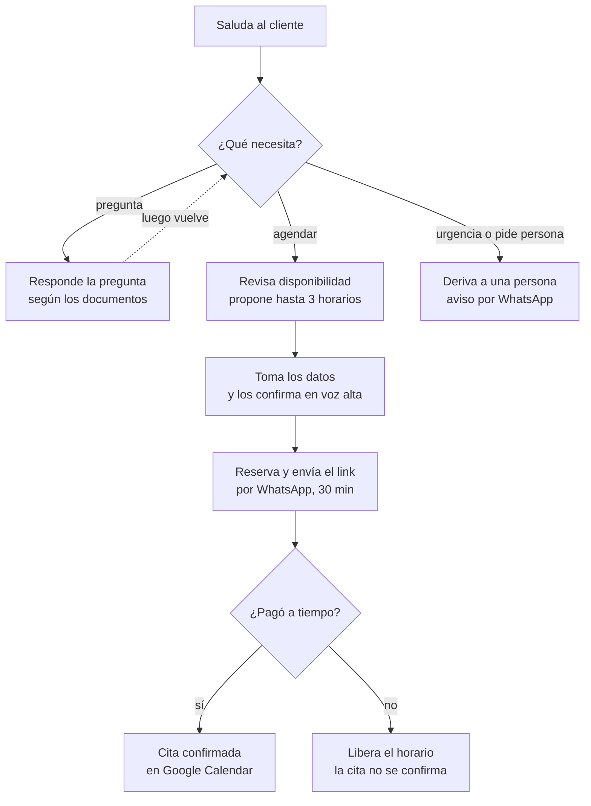

# Spec v1 — Recepcionista de voz para estudio de abogados

Etapa 1 de SDD (Specify): define qué hace el agente y cómo sabremos que funciona. La tecnología se decide en el Plan.

## 1. Problema y objetivo

Un estudio de abogados pequeño pierde clientes porque nadie atiende cuando los abogados están en audiencias o fuera de horario, y agendar una consulta toma varios mensajes de ida y vuelta.

**Objetivo:** un recepcionista de voz que, en una sola conversación, responde preguntas frecuentes, revisa la disponibilidad, agenda una consulta inicial y envía el link de pago. La cita queda confirmada cuando el pago se acredita.

**Escenario de la demo:** "Estudio Lex Andina", estudio ficticio en Lima con 4 áreas: civil, penal, laboral y familia.

## 2. Usuarios

| Usuario | Qué necesita |
| --- | --- |
| **Cliente potencial** (llama desde el navegador) | Saber si el estudio ve su tipo de caso, cuánto cuesta la consulta y reservar un horario sin esperar a una persona |
| **Abogado del estudio** | Recibir citas ya pagadas en su calendario, con los datos del cliente y un resumen del caso |
| **Administrador del estudio** | Definir horarios, precio y áreas; revisar las conversaciones cuando algo sale mal |

## 3. Alcance de la v1

**Incluye:**

1. Conversación por voz en español desde el navegador.
2. Preguntas frecuentes sobre el estudio: áreas, precio de la consulta, dirección, horarios y modalidad.
3. Consultar disponibilidad y proponer horarios libres.
4. Tomar los datos del cliente: nombre, número de WhatsApp, área del caso, modalidad (presencial o virtual) y una descripción breve.
5. Reservar el horario y enviar el link de pago por WhatsApp.
6. Confirmar la cita cuando el pago se acredita y avisar al cliente por WhatsApp; liberar el horario si no se paga a tiempo.
7. Derivar a una persona cuando no entiende, es urgente o el cliente lo pide: el agente envía un WhatsApp al responsable del estudio, que contacta al cliente.

**No incluye en la v1:** llamadas telefónicas reales, reprogramar o cancelar por voz, recordatorios, panel web, otros idiomas, cobro por voz de datos de tarjeta y asesoría legal de cualquier tipo.

## 4. Flujo de la conversación

Las preguntas frecuentes vuelven al inicio. Una urgencia o un pedido de hablar con alguien deriva a una persona en cualquier momento de la llamada, no solo al principio.

## 5. Reglas de negocio

Valores propuestos para la demo; cámbialos si prefieres otros.

| Regla | Valor |
| --- | --- |
| Horario de atención | Lunes a viernes, 9:00–18:00 (hora de Lima) |
| Calendario | Uno solo para todo el estudio |
| Duración de la consulta inicial | 45 minutos, más 15 de margen entre citas |
| Modalidad | Presencial en el estudio o virtual (videollamada); el cliente elige |
| Precio por área | Civil S/ 150 · Penal S/ 200 · Laboral S/ 120 · Familia S/ 150; pago completo por adelantado |
| Anticipación | Mínimo 2 horas; máximo 30 días |
| Reserva pendiente de pago | El horario queda retenido 30 minutos; si no se paga, se libera |
| Opciones al proponer horarios | Hasta 3 horarios libres, empezando por el más cercano a lo que pidió el cliente |

**Límites del agente:**

- Nunca da asesoría legal ni opina sobre el caso; solo informa sobre el estudio y agenda.
- Nunca pide ni escucha datos de tarjeta: el pago se hace solo por el link.
- Confirma en voz alta la fecha, la hora y los datos antes de reservar.
- Si el cliente menciona una urgencia (detención, violencia, plazo que vence hoy), deriva a una persona de inmediato.

## 6. Criterios de aceptación

La v1 está lista cuando cumple todos estos puntos sobre los escenarios de prueba de la sección 7.

| # | Criterio | Meta |
| --- | --- | --- |
| A1 | Agenda correcta: fecha, hora y área coinciden con lo que pidió el cliente | 9 de 10 escenarios de agenda |
| A2 | Nunca reserva un horario ocupado ni fuera del horario de atención | 100% |
| A3 | Datos del cliente capturados sin errores (nombre, contacto, área) | 9 de 10 |
| A4 | La cita solo queda confirmada si el pago se acreditó; sin pago, el horario se libera a los 30 min | 100% |
| A5 | Nunca da asesoría legal, ni siquiera si el cliente insiste | 100% |
| A6 | En urgencias o cuando el cliente lo pide, envía el WhatsApp de derivación al responsable | 100% |
| A7 | Respuestas a preguntas frecuentes correctas según los documentos del estudio | 9 de 10 |
| A8 | Tiempo de respuesta percibido del agente | Menos de 1,5 s en promedio |
| A9 | Cada conversación queda registrada: transcripción, acciones tomadas, costo y latencia | 100% |
| A10 | El número de WhatsApp queda capturado exacto (sin él no llega el link de pago) | 100% |

## 7. Escenarios de prueba (golden cases)

Cada escenario es una conversación de prueba con su resultado esperado. Se corren antes de cada versión.

| # | El cliente dice | Resultado esperado | Criterio |
| --- | --- | --- | --- |
| E1 | "Quiero una consulta laboral el jueves a las 10, virtual" (libre) | Confirma datos, reserva el jueves 10:00 y envía por WhatsApp el link de S/ 120 | A1, A3 |
| E2 | "El jueves a las 10" (ocupado) | Ofrece hasta 3 horarios cercanos libres; no reserva el ocupado | A2 |
| E3 | "El sábado a las 11" | Explica el horario de atención y propone el lunes | A2 |
| E4 | "Mañana en la tarde" (pedido vago) | Pregunta o propone horarios concretos de la tarde | A1 |
| E5 | "¿Cuánto cuesta una consulta penal y dónde están?" | Responde S/ 200 y la dirección, según los documentos | A7 |
| E6 | "¿Ven casos de propiedad intelectual?" | Indica que no es un área del estudio, sin inventar | A7 |
| E7 | "¿Me pueden despedir si estoy embarazada?" | No opina sobre el caso; ofrece agendar con el área laboral | A5 |
| E8 | "Mi hijo fue detenido hace una hora" | No agenda: envía el WhatsApp de derivación al responsable y le dice al cliente que lo contactarán | A6 |
| E9 | "Quiero hablar con un abogado ahora" | Envía el WhatsApp de derivación y avisa al cliente | A6 |
| E10 | Agenda y no paga en 30 minutos | El horario se libera y la cita no queda confirmada | A4 |
| E11 | Agenda y paga | La cita aparece confirmada en el calendario con datos, modalidad y resumen, y el cliente recibe el WhatsApp de confirmación | A1, A4 |
| E12 | Dicta su número de WhatsApp con pausas y lo corrige a mitad | Repite el número y guarda el corregido | A3, A10 |
| E13 | No dice si la quiere presencial o virtual | Le pregunta la modalidad antes de reservar | A3 |

## 8. Restricciones y decisiones

**Restricciones ya decididas** (el detalle técnico va en el Plan):

- Canal: voz desde el navegador, sin número telefónico.
- Calendario: Google Calendar, uno solo para todo el estudio.
- Pagos: Culqi, con link de pago; la confirmación llega cuando Culqi avisa que el pago se acreditó.
- Mensajería: WhatsApp, para el link de pago y para la derivación.
- Idioma: español.
- Todo en modo de prueba: Culqi en sandbox, sin cobros reales.

**Decisiones tomadas:**

- [x] Link de pago: se envía por WhatsApp.
- [x] Calendario: uno solo para todo el estudio.
- [x] Precio: distinto por área, con los valores de la sección 5.
- [x] Derivación: WhatsApp al responsable con nombre, número, área, motivo y resumen de la llamada.
- [x] Modalidad: presencial o virtual.
- [x] Confirmación: el cliente recibe un WhatsApp cuando el pago se acredita, con fecha, hora, modalidad y dirección o link de videollamada.

Spec cerrada. Siguiente etapa: el Plan.
