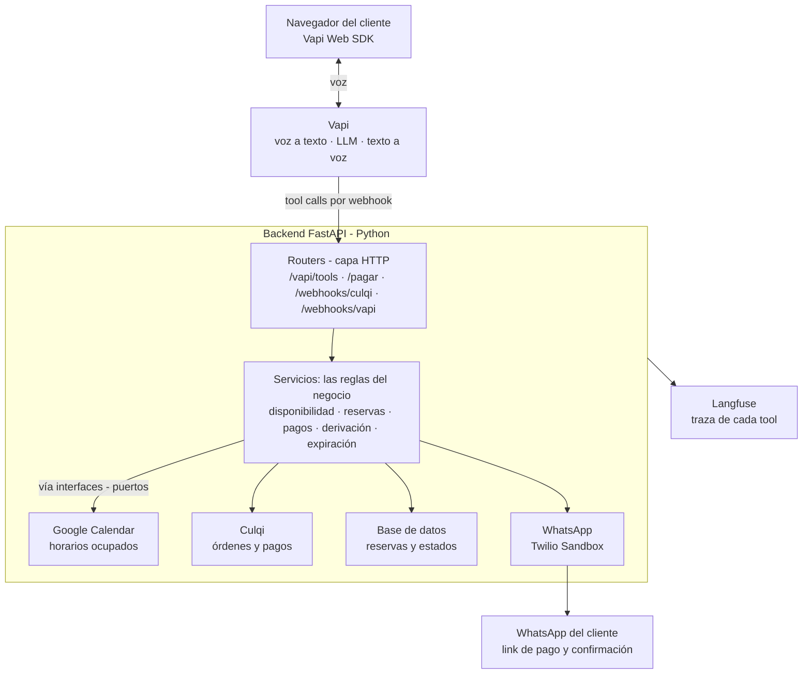

# Plan v1 — Recepcionista de voz

Etapa 2 de SDD: cómo construimos lo que pide la Spec. Cada decisión lleva su porqué.

## 1. Decisiones clave

La plataforma de voz resuelve el audio; nosotros construimos el cerebro: las tools, las reglas de negocio, los pagos y la observabilidad, en Python.

| Tema | Elegimos | Por qué sí | Por qué no la alternativa |
| --- | --- | --- | --- |
| Voz en el navegador | **Vapi** (Web SDK + tools por webhook) | Resuelve reconocimiento de voz, voz sintética, turnos e interrupciones; tiene SDK web y crédito de prueba | **LiveKit Agents** (Python puro): más control, pero mucho más trabajo de audio y despliegue. Buena opción para la v2 |
| Backend | **FastAPI** + Pydantic v2 | Valida cada tool con su esquema, es asíncrono y documenta solo en `/docs` | Flask o Django: sin validación nativa con Pydantic o demasiado pesado para una API |
| Preguntas frecuentes | **Información del estudio en el prompt** (1–2 páginas) | Es poca información: sin búsqueda, menos latencia, menos piezas | **RAG**: se justifica cuando los documentos crecen; hoy agregaría latencia en cada respuesta |
| Disponibilidad | **Google Calendar como fuente de verdad** (consulta de horarios ocupados) | El estudio ya ve y edita sus citas ahí; nada se desincroniza | Agenda propia en base de datos: habría que sincronizarla con el calendario real |
| Reservas y estados | **Base de datos propia** (SQLModel; SQLite en desarrollo, PostgreSQL en producción) | Guarda el estado del pago, los datos del cliente y la auditoría, que el calendario no maneja | Guardar todo en el calendario: no sirve para estados ni para consultas |
| Retención del horario | **Evento "PENDIENTE" en el calendario** + tarea que lo libera a los 30 min | Bloquea el horario de inmediato para otros clientes | Reservar solo al pagar: dos personas podrían pagar el mismo horario |
| Pago | **Página de pago propia con Culqi Checkout**; enviamos su link por WhatsApp | Culqi no entrega un link por API para órdenes: su Checkout se embebe en una página, así que la servimos nosotros ([docs de Culqi](https://docs.culqi.com/es/documentacion/pagos-online/ordenes-de-pago/resumen)) | Pedir la tarjeta por voz: riesgo de seguridad y normas de datos de tarjeta |
| Confirmación del pago | **Webhook de Culqi** (`order.status.changed`) y resultado del cargo con tarjeta | El pago puede llegar minutos después; el webhook es la confirmación confiable | Consultar el estado cada cierto tiempo: más lento y más llamadas |
| WhatsApp | **Interfaz propia + Twilio WhatsApp Sandbox** en la demo | Prueba gratis y rápida; detrás de una interfaz, cambiar a la API oficial de Meta es cambiar una clase | **WhatsApp Cloud API de Meta** directo: requiere verificar el negocio y plantillas aprobadas. Queda para producción |
| Transcripción (voz a texto) | **ASR en streaming en español** (p. ej. Deepgram, configurado en Vapi) y, si el proveedor lo permite, palabras clave ("Lex Andina", nombres de las áreas) | Transcribe mientras el cliente habla: baja la latencia (A8). Es un modelo Transformer, el tipo que la lecture 2 del M4 recomienda para entender audio en tiempo real | **Whisper por tramos**: muy preciso, pero procesa el audio por partes y agrega espera en una conversación en vivo |
| LLM del agente | **Modelo rápido de OpenAI** (variante mini), configurable | En voz la latencia manda; las tareas son acotadas | Un modelo grande: más lento y caro sin mejorar estas tareas |
| Observabilidad | **Langfuse** para el backend + registros de llamada de Vapi | Ya lo dominas; traza cada tool con su latencia y resultado | Solo logs: sin jerarquía ni costos |
| Webhooks en desarrollo | **ngrok** (URL pública temporal) | Vapi y Culqi necesitan llegar a tu backend local | Desplegar en cada cambio: lento para iterar |

## 2. Arquitectura



Los routers solo reciben y responden HTTP; los servicios aplican las reglas y hablan con Calendar, Culqi, la base de datos y WhatsApp a través de interfaces. El cliente paga desde el link de WhatsApp en nuestra página `/pagar`, y Culqi avisa el pago a `/webhooks/culqi`.

## 3. Estructura de carpetas y SOLID

Arquitectura hexagonal (puertos y adaptadores): las reglas del negocio no saben que existen Google, Culqi o Twilio. Así cada servicio externo se cambia o se simula en las pruebas sin tocar la lógica.

```text
voice-receptionist/
├── app/
│   ├── main.py              # crea la app FastAPI y registra los routers
│   ├── config.py            # settings con pydantic-settings (.env)
│   ├── api/                 # capa HTTP: traduce HTTP <-> servicios, sin lógica
│   │   ├── vapi_tools.py    # POST /vapi/tools (recibe las tool calls)
│   │   ├── payments.py      # GET /pagar/{id} y POST /payments/charge
│   │   └── webhooks.py      # POST /webhooks/culqi y /webhooks/vapi
│   ├── domain/              # reglas puras, sin librerías externas
│   │   ├── models.py        # Booking, Client, Area, BookingStatus
│   │   ├── rules.py         # horario, duración, anticipación, precios
│   │   └── ports.py         # interfaces: CalendarPort, PaymentPort, MessagingPort, BookingRepository
│   ├── services/            # casos de uso
│   │   ├── availability.py  # horarios libres
│   │   ├── booking.py       # reservar, confirmar, expirar
│   │   ├── payment.py       # crear orden, procesar webhook
│   │   └── handoff.py       # derivar a una persona
│   ├── adapters/            # implementaciones concretas de los puertos
│   │   ├── google_calendar.py
│   │   ├── culqi.py
│   │   ├── twilio_whatsapp.py
│   │   └── sql_repository.py
│   ├── schemas/tools.py     # contratos Pydantic de cada tool
│   ├── jobs/expire_holds.py # libera horarios sin pagar
│   └── observability.py     # Langfuse
├── assistant/               # config de Vapi versionada
│   ├── system_prompt.md
│   ├── estudio.md           # información del estudio para las preguntas frecuentes
│   └── tools.json
├── templates/pagar.html     # página con Culqi Checkout
├── tests/                   # unit (con fakes) e integration
├── specs/                   # 01-spec.md, 02-plan.md, 03-tasks.md
├── .env.example
├── requirements.txt
├── requirements-dev.txt
└── README.md
```

| Principio | Cómo lo aplicamos |
| --- | --- |
| **S** — Responsabilidad única | Cada servicio hace un caso de uso; los routers solo traducen HTTP; los adaptadores solo hablan con su servicio externo |
| **O** — Abierto/cerrado | Una tool nueva = un handler nuevo registrado en el dispatcher, sin tocar los existentes |
| **L** — Sustitución de Liskov | `TwilioWhatsApp` y un futuro `MetaWhatsApp` cumplen el mismo `MessagingPort`: cualquiera funciona donde se espera el puerto |
| **I** — Segregación de interfaces | Puertos chicos y separados (calendario, pagos, mensajería, repositorio) en lugar de un "cliente externo" gigante |
| **D** — Inversión de dependencias | Los servicios reciben los puertos por constructor (inyección con `Depends` de FastAPI); en los tests se pasan fakes |

## 4. Contratos de las tools

Vapi llama a un solo endpoint, `POST /vapi/tools`, con la lista de tool calls; el dispatcher valida los argumentos con el esquema Pydantic de cada tool y responde `{"results": [{"toolCallId", "result"}]}` con `result` como texto ([docs de Vapi](https://docs.vapi.ai/tools/custom-tools.md)). Si la validación falla, devuelve `error` con un mensaje que el agente pueda usar para repreguntar.

| Tool | Entrada | Salida | Regla que cumple |
| --- | --- | --- | --- |
| `check_availability` | `area`, `date` (YYYY-MM-DD), `preferred_time` opcional | Hasta 3 horarios libres o el motivo por el que no hay | A2: solo horarios libres y dentro del horario de atención |
| `create_booking` | `area`, `start` (fecha y hora ISO), `modality` (presencial o virtual), `client_name`, `client_whatsapp` (+51…), `summary` | `booking_id`, precio y "link enviado por WhatsApp" | A1, A3, A4: valida de nuevo el horario, crea el evento PENDIENTE y envía el link (la orden de Culqi se crea después, en la página de pago) |
| `handoff_to_human` | `reason` (urgencia, pedido del cliente, no entiende), `client_name`, `client_whatsapp`, `area` opcional, `summary` | "Aviso enviado" | A6: WhatsApp al responsable con los datos y el resumen |

**Por qué `create_booking` vuelve a validar el horario:** entre la consulta y la reserva otro cliente pudo tomarlo. La regla de no reservar ocupados (A2) se garantiza en el servidor, no se confía en el LLM.

**Por qué no hay tool de preguntas frecuentes:** la información del estudio va en el prompt (ver decisiones). Si crece, se agrega una tool `search_faq` con RAG sin cambiar las demás (principio abierto/cerrado).

## 5. Estados de la reserva y flujo del pago

Una reserva solo tiene 3 estados y cada cambio lo dispara un evento concreto.

| Estado | Cómo se llega | Qué pasa en el calendario | WhatsApp al cliente |
| --- | --- | --- | --- |
| `PENDING_PAYMENT` | `create_booking` | Evento "PENDIENTE — nombre" que bloquea el horario | Link de pago |
| `CONFIRMED` | Culqi confirma el pago | El evento pasa a "CONFIRMADA — nombre · área · modalidad" con el resumen | Confirmación con fecha, hora y dirección o link de videollamada |
| `EXPIRED` | Pasan 30 min sin pago | Se borra el evento y el horario queda libre | Aviso de que la reserva venció |

**Flujo del pago:**

1. `create_booking` guarda la reserva en `PENDING_PAYMENT`, crea el evento PENDIENTE en el calendario y envía por WhatsApp el link a nuestra página `/pagar/{booking_id}`. Todavía no existe orden en Culqi.
2. El cliente abre la página y **escribe su email** (no se dicta por voz: así no hay errores de transcripción).
3. Recién entonces el backend crea la orden en Culqi por el precio del área, con el email real del cliente (`start_payment`).
4. La página abre Culqi Checkout y el cliente paga con tarjeta o Yape.
5. Culqi avisa al webhook `/webhooks/culqi`; el backend consulta la orden en la API, busca la reserva y la pasa a `CONFIRMED`.
6. El backend actualiza el evento y envía el WhatsApp de confirmación.
7. Cada minuto, `expire_holds` pasa a `EXPIRED` las reservas pendientes con más de 30 minutos, tengan o no una orden creada.

**Por qué la orden se crea en la página y no durante la llamada:** Culqi pide el email del cliente para crear la orden. Pedirlo por voz es propenso a errores, y en la página el cliente lo escribe. Además, si el cliente nunca abre el link, no queda una orden de más en Culqi.

**Idempotencia:** Culqi puede enviar el mismo aviso más de una vez. Si la reserva ya está `CONFIRMED`, el webhook responde 200 y no hace nada; así el cliente no recibe dos confirmaciones.

## 6. Observabilidad, pruebas y evaluación

**Observabilidad (cubre A9):**

- Langfuse: una traza por llamada, agrupada por el `call.id` de Vapi; un span por tool con sus argumentos, resultado, latencia y errores.
- Webhook `end-of-call-report` de Vapi: guarda transcripción, duración y costo de cada llamada en la base de datos.
- Logs estructurados con el `booking_id` en cada línea, para seguir una reserva de punta a punta.

**Pruebas en 3 niveles:**

| Nivel | Qué prueba | Cómo |
| --- | --- | --- |
| Unitarias | Reglas y servicios: horarios libres, precios, anticipación, expiración, idempotencia | pytest con fakes de los puertos; sin internet ni costo |
| Integración | Endpoints: formato de Vapi, webhook de Culqi, página de pago | `TestClient` de FastAPI con adaptadores falsos |
| Golden cases | Los 13 escenarios de la Spec (E1–E13) | Llamadas de prueba reales con Vapi en modo de prueba; resultado registrado en una tabla por versión |

**Evaluación:** por cada versión se corren E1–E13 y se mide contra A1–A10: agendas correctas, horarios ocupados respetados, derivaciones, latencia promedio. Un cambio de prompt o de modelo solo entra si no empeora ninguna métrica.

**Calidad de la transcripción** (lecture 2 del M4: los errores del ASR se propagan al LLM y el WER es contextual):

| Métrica | Qué mide | Meta |
| --- | --- | --- |
| WER general | Palabras mal transcritas / palabras de la referencia, sobre las grabaciones de E1–E13 | Se registra por versión; sirve para comparar proveedores de ASR |
| Precisión de entidades críticas | ¿Se capturaron exactos el número de WhatsApp, la fecha, la hora y el área? | 100% en el WhatsApp (A10); 9 de 10 en el resto (A3) |

Si un escenario falla, el diagnóstico sigue este orden: ¿el audio fue claro? → ¿el ASR transcribió bien? → ¿el LLM entendió bien? Cambiar el LLM no arregla una transcripción mala.

## 7. Seguridad y riesgos

**Seguridad:**

- Secretos solo en `.env` (Vapi, Google, Culqi, Twilio, Langfuse), validados al arrancar con pydantic-settings.
- `/vapi/tools` exige un secreto compartido en el encabezado que Vapi envía; sin él responde 401.
- El webhook de Culqi no se cree a ciegas: el backend consulta la orden en la API de Culqi antes de confirmar.
- La página de pago usa un identificador difícil de adivinar (UUID), no un número correlativo.
- Los datos de tarjeta nunca pasan por nuestro servidor: los maneja Culqi Checkout.
- Datos personales mínimos y ninguno en los parámetros de las URLs.

| Riesgo | Mitigación |
| --- | --- |
| El reconocimiento de voz entiende mal un número o una fecha | El agente repite y confirma antes de reservar (E12); el esquema valida formato +51 y fechas |
| El LLM "inventa" un horario libre | Los horarios solo salen de `check_availability`, y `create_booking` vuelve a validar en el servidor |
| Latencia alta en voz | Modelo mini, prompt corto, tools que responden en menos de 500 ms; se mide en cada versión |
| El cliente pide asesoría legal | Regla explícita en el prompt + escenario E7 en cada evaluación |
| WhatsApp Sandbox exige que el número se una primero al sandbox | Documentarlo en el README; en producción se usa la API oficial con plantillas aprobadas |
| Dos clientes eligen el mismo horario a la vez | Revalidación al reservar + el evento PENDIENTE bloquea el horario apenas se crea |
